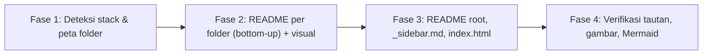

# 🧸 eli5-visual-docs

**Agent Skill universal** yang mengubah seluruh codebase (bahasa & framework apa pun) menjadi **web dokumentasi interaktif** ala Swagger/Docsify — dijelaskan dengan gaya **ELI5** (analogi sehari-hari, bahasa super sederhana), dilengkapi **visual otomatis**, dan terstruktur **per folder**.

```
Kode rumit  ──►  🤖 Agent + skill ini  ──►  📚 Web docs yang bisa dibaca nenekmu
```

## ✨ Fitur

| Fitur | Penjelasan |
|---|---|
| 🔍 Auto-detect stack | Baca `package.json`, `pubspec.yaml`, `go.mod`, `*.csproj`, `requirements.txt`, `Cargo.toml`, dll. lalu tentukan tipe: `web-ui`, `mobile-ui`, `backend-api`, `cli-library` |
| 🧸 Gaya ELI5 + akurat | Setiap analogi wajib diikuti baris `🔧 Aslinya:` berisi nama file/fungsi/props asli |
| 📸 Visual otomatis | Web → screenshot Playwright · Mobile → golden test / simulator · Backend/CLI → diagram Mermaid + contoh input/output |
| 📂 Per folder, bottom-up | `README.md` di tiap folder fitur, lalu dirangkum ke atas |
| 🌐 Web tanpa build | `index.html` Docsify + `_sidebar.md` + Search + Copy Code + Mermaid, siap GitHub Pages |
| ♻️ Aman & bisa diulang | Tidak menyentuh source code; konten dibungkus penanda sehingga README buatan manusia tidak tertimpa |

## 📁 Struktur Repo

```
eli5-visual-docs/
├── SKILL.md                            # Instruksi utama untuk AI agent
├── README.md                           # File ini
└── templates/
    ├── index.html                      # Docsify (Search, Copy Code, Mermaid, Zoom)
    ├── folder-readme-template.md       # Template README per sub-folder
    ├── root-readme-template.md         # Template halaman depan
    └── _sidebar-template.md            # Contoh format sidebar
```

## 📦 Instalasi

Skill ini mengikuti format standar **Agent Skills** (folder berisi `SKILL.md` dengan frontmatter `name` + `description`). Salin/clone foldernya ke direktori skill milik agent yang kamu pakai:

| Agent | Lokasi skill global | Lokasi skill per proyek |
|---|---|---|
| Antigravity | `~/.gemini/antigravity/skills/eli5-visual-docs/` | `<proyek>/.agents/skills/eli5-visual-docs/` |
| Claude Code | `~/.claude/skills/eli5-visual-docs/` | `<proyek>/.claude/skills/eli5-visual-docs/` |
| Gemini CLI | `~/.gemini/skills/eli5-visual-docs/` | `<proyek>/.gemini/skills/eli5-visual-docs/` |
| Codex / Cursor / lainnya | Folder skill/rules agent tsb. | Atau rujuk langsung: *"ikuti instruksi di `/path/eli5-visual-docs/SKILL.md`"* |

Contoh (global, via symlink agar mudah di-update):

```bash
git clone <url-repo-ini> ~/skills/eli5-visual-docs
mkdir -p ~/.claude/skills
ln -s ~/skills/eli5-visual-docs ~/.claude/skills/eli5-visual-docs
```

> Pastikan folder `templates/` ikut tersalin — `SKILL.md` merujuk ke sana.

## 🚀 Cara Memanggil

Buka proyek yang ingin didokumentasikan di coding agent, lalu ketik salah satu:

```text
/eli5-visual-docs
```

```text
Pakai skill eli5-visual-docs untuk mendokumentasikan seluruh codebase ini.
```

```text
Jalankan eli5-visual-docs, tapi hanya untuk folder src/features/payment.
```

```text
Update dokumentasi eli5-visual-docs untuk perubahan sejak commit terakhir.
```

Agent akan menjalankan:



## 🧰 Dependensi Opsional

Tidak ada dependensi wajib. Visual dipilih otomatis; jika alat tidak tersedia, skill jatuh ke diagram Mermaid.

| Untuk | Alat | Instalasi |
|---|---|---|
| Screenshot web | [Playwright](https://playwright.dev) (CLI atau MCP) | `npx playwright install chromium` |
| Screenshot Flutter | Flutter SDK (golden test) | sudah termasuk `flutter_test` |
| Screenshot iOS | Xcode + Simulator | `xcrun simctl` |
| Screenshot Android | Android SDK Platform Tools | `adb` |
| Preview docs | Node.js **atau** Python 3 | `npx docsify-cli` / `python3 -m http.server` |
| Validasi Mermaid (opsional) | `@mermaid-js/mermaid-cli` | `npx @mermaid-js/mermaid-cli` |

## 👀 Preview Web Dokumentasi Secara Lokal

Setelah skill selesai, di root proyek kamu akan ada `index.html`, `_sidebar.md`, `README.md`, dan `.nojekyll`. Jalankan:

```bash
# Opsi 1 — Docsify CLI (live reload)
npx docsify-cli serve .
# buka http://localhost:3000

# Opsi 2 — Tanpa Node.js
python3 -m http.server 3000
# buka http://localhost:3000
```

> ⚠️ Jangan buka `index.html` dengan klik dua kali (`file://`) — Docsify butuh server karena memuat Markdown via `fetch`.
>
> Jika proyek sudah punya `index.html` sendiri (mis. Vite), skill akan membuat `docs.html` sebagai gantinya → buka `http://localhost:3000/docs.html`.

### Publikasi ke GitHub Pages

1. Commit & push `index.html`, `_sidebar.md`, `.nojekyll`, semua `README.md` dan folder `assets/`.
2. GitHub → **Settings → Pages → Build and deployment → Deploy from a branch** → pilih branch dan folder `/ (root)`.
3. Buka `https://<user>.github.io/<repo>/`.

## 🛡️ Jaminan Keamanan

- Tidak pernah mengubah source code — hanya `README.md`, `assets/*.png`, `_sidebar.md`, `index.html`/`docs.html`, `.nojekyll`.
- File sementara (script screenshot, golden test) dihapus otomatis.
- Konten buatan skill dibungkus `<!-- eli5-visual-docs:start -->` … `<!-- eli5-visual-docs:end -->`, sehingga isi README yang ditulis manusia tetap aman saat skill dijalankan ulang.
- Kredensial asli tidak pernah dimasukkan ke dokumentasi atau screenshot.

## 📝 Lisensi

MIT
