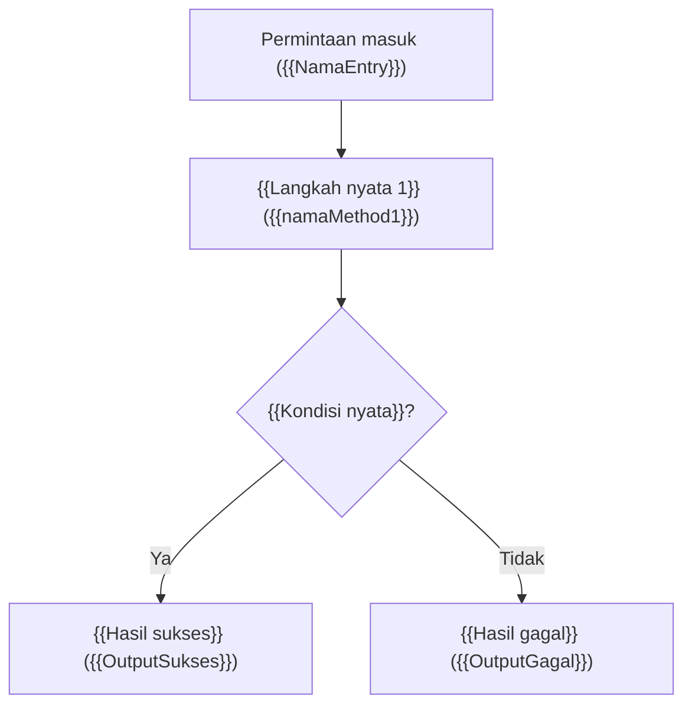

<!-- babydocs:start -->
<!-- babydocs:hash={{HASH_FOLDER_DARI_PETA_PROYEK}} -->
<!--
  TEMPLATE README SUB-FOLDER (MENDALAM: LEVEL KOMPONEN / CLASS / FUNGSI / ALUR KODE)
  - Jika folder berisi 1–5 komponen/file: bedah SEMUANYA secara detail di bagian "## 🧩 Bedah Komponen, Class & Fungsi" (setiap komponen/class WAJIB punya sub-judul ### sendiri, DILARANG diringkas jadi 1 tabel 1-baris!).
  - Jika folder berisi > 5 komponen reusable/file kompleks: buat halaman detail terpisah (<nama>.md memakai templates/component-doc-template.md) untuk tiap komponen/file, lalu tautkan dari sini dan dari _sidebar.md.
  - Hapus komentar petunjuk ini sebelum menyimpan, KECUALI penanda babydocs:start / babydocs:hash / babydocs:end.
-->

# {{EMOJI}} {{NAMA_FOLDER_RAMAH}}

> **Singkatnya:** {{SATU_KALIMAT_ELI5_SPESIFIK — jelaskan peran nyata folder ini}}

📁 Lokasi: `{{PATH_FOLDER_DARI_ROOT}}` · 🧩 Tipe: `{{web-ui | mobile-ui | backend-api | cli-library}}`

---

## 🪆 Penjelasan Super Sederhana

{{ANALOGI_BESAR — 3 s.d. 6 kalimat pendek yang spesifik terhadap perilaku kode di folder ini.}}

> 🔧 **Aslinya:** {{RINGKASAN_TEKNIS — sebutkan class/komponen/entry utama dan cara folder ini dipakai.}}

---

## 👀 Lihat Wujudnya

<!-- [A] UNTUK web-ui / mobile-ui: WAJIB Screenshot nyata hasil capture (Playwright / golden test / simulator) -->
### 📸 Screenshot


*{{Keterangan: komponen/halaman dan varian apa saja yang tampil di gambar.}}*

<!-- [B] DIAGRAM ALUR NYATA (wajib pakai nama class/method/state asli, minimal 3 node bermakna) -->
### 🗺️ Diagram Alur



---

## 🧩 Bedah Komponen, Class & Fungsi

<!--
  ATURAN WAJIB:
  - JANGAN ringkas banyak komponen menjadi 1 tabel 1-baris!
  - Setiap komponen/class/service penting HARUS punya sub-judul ### sendiri di bawah ini
    ATAU punya halaman detail terpisah (<nama>.md) yang ditautkan dari tabel katalog.
-->

### 1. `{{NamaClassAtauKomponen}}`

{{2–3 kalimat analogi ELI5 yang menjelaskan persis tugasnya.}}

> 🔧 **Aslinya:** `{{nama_file.ext}}` → `{{deklarasi asli}}`

<!-- Jika punya screenshot khusus komponen ini: -->


**Cara kerja di dalam kode:**
1. {{Langkah 1 sesuai alur if/else / build / logic nyata di file}} (`{{simbol/kondisi}}`)
2. {{Langkah 2 — kasus khusus seperti loading, disabled, error, retry, fallback}} (`{{simbol/kondisi}}`)

**Props / Parameter Lengkap:**

| Nama | Tipe | Default / Wajib | Artinya (bahasa sederhana) |
|---|---|---|---|
| `{{prop1}}` | `{{String}}` | **Wajib** | {{penjelasan singkat}} |
| `{{prop2}}` | `{{bool}}` | `false` | {{apa efeknya jika true}} |

**Method / Aksi Lengkap:**

| Method | Input | Output / Efek | Cara Kerjanya (bahasa sederhana) |
|---|---|---|---|
| `{{methodA(param)}}` | `{{param: Tipe}}` | `{{Return / emit State / HTTP call}}` | {{apa yang dilakukan langkah demi langkah}} |

**Contoh Pemakaian:**

```{{bahasa}}
{{CONTOH_NYATA_SIAP_PAKAI}}
```

---

### ⚙️ Fungsi Lepas & Helper

| Fungsi | File | Input | Output | Cara Kerjanya (bahasa sederhana) |
|---|---|---|---|---|
| `{{namaFungsi(a, b)}}` | `{{file.ext}}` | `{{a: Tipe, b: Tipe}}` | `{{TipeReturn}}` | {{penjelasan spesifik termasuk edge case}} |

---

## 📋 Ringkasan File

| Nama File | Isi Utama | Halaman Detail / Bagian |
|---|---|---|
| `{{file_1.ext}}` | `{{ClassA}}`, `{{helperB()}}` | [Lihat detail](#_1-classa) *(atau `[Lihat detail](./class_a.md)`)* |

<!-- Hapus bagian ini jika folder tidak punya sub-folder ber-README -->
### 📂 Sub-folder

| Folder | Ibaratnya | Buka |
|---|---|---|
| `{{nama-subfolder}}` | {{ringkasan analogi 1 kalimat}} | [README]({{path/dari/root/ke/subfolder/README.md}}) |

---

## 🔗 Berhubungan Dengan

- **Dipakai oleh:** {{folder/file yang memanggil folder ini — tautkan README-nya}}
- **Memakai:** {{folder/library yang dipanggil folder ini}}

<!-- babydocs:end -->
