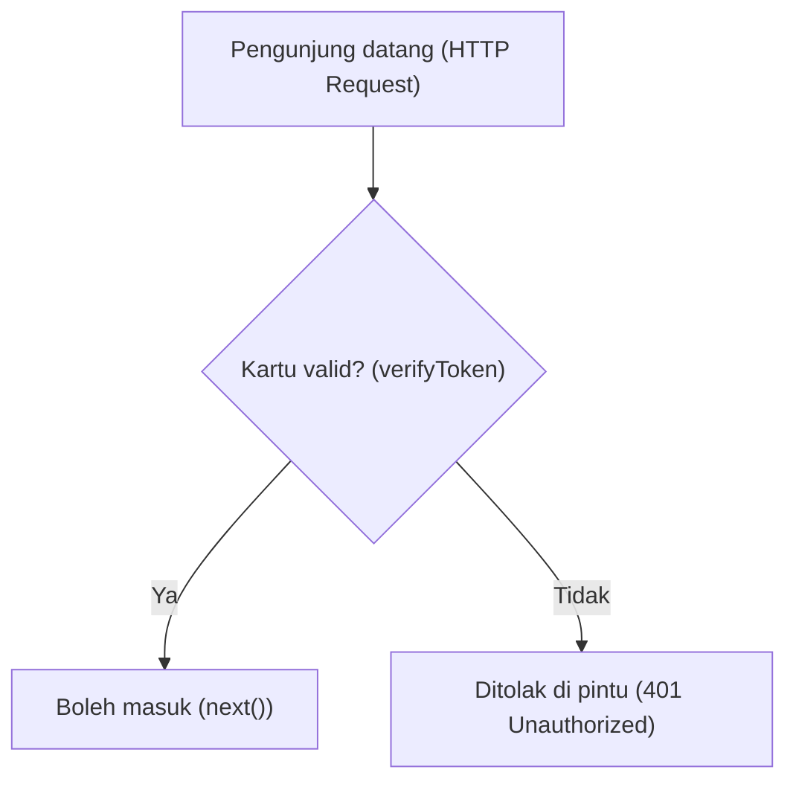
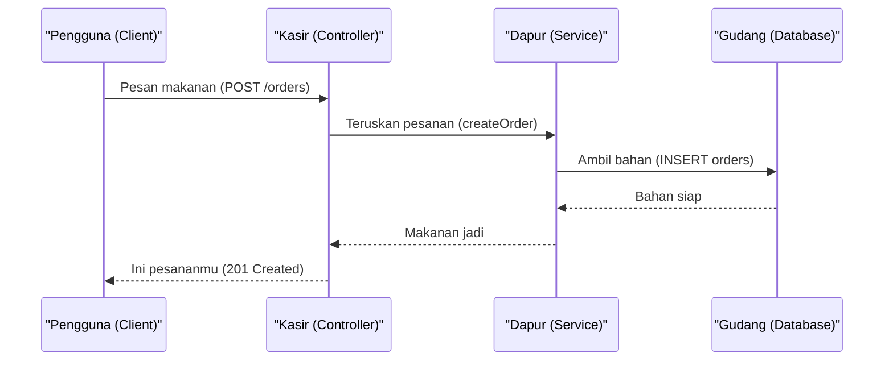

<!-- eli5-visual-docs:start -->
<!--
  TEMPLATE README SUB-FOLDER
  - Ganti semua {{PLACEHOLDER}}.
  - Hapus bagian yang tidak relevan (mis. "Screenshot" untuk folder backend, atau "Diagram Alur" jika sudah cukup dengan screenshot).
  - Hapus semua komentar HTML petunjuk ini sebelum menyimpan, KECUALI penanda eli5-visual-docs:start / end.
-->

# {{EMOJI}} {{NAMA_FOLDER_RAMAH}}

> **Singkatnya:** {{SATU_KALIMAT_ELI5 — mis. "Folder ini ibarat satpam di pintu depan: dia memastikan hanya orang yang punya kartu yang boleh masuk."}}

📁 Lokasi: `{{PATH_FOLDER_DARI_ROOT}}` · 🧩 Tipe: `{{web-ui | mobile-ui | backend-api | cli-library}}`

---

## 🧸 Penjelasan Super Sederhana

{{ANALOGI_BESAR — 3 s.d. 6 kalimat pendek. Satu dunia analogi untuk seluruh folder.}}

> 🔧 **Aslinya:** {{RINGKASAN_TEKNIS — mis. "Modul autentikasi berbasis JWT. Entry: `auth.module.ts`, dipakai oleh `app.module.ts`."}}

### {{EMOJI}} {{ANALOGI_BAGIAN_1 — mis. "Kasir yang Mengecek Kartu Member"}}

{{2–4 kalimat pendek menjelaskan bagian ini dengan analogi.}}

> 🔧 **Aslinya:** `{{nama_file.ext}}` → `{{namaFungsi(param)}}` — {{penjelasan teknis singkat & akurat}}

### {{EMOJI}} {{ANALOGI_BAGIAN_2}}

{{2–4 kalimat pendek.}}

> 🔧 **Aslinya:** `{{nama_file.ext}}` → props `{{propA}}`, `{{propB}}` — {{penjelasan teknis singkat}}

---

## 👀 Lihat Wujudnya

<!-- ===== PILIH SALAH SATU / KEDUANYA SESUAI TIPE FOLDER ===== -->

<!-- [A] UNTUK web-ui / mobile-ui: Screenshot -->
### 📸 Screenshot


*{{Keterangan: apa yang sedang kita lihat, tunjuk bagian penting.}}*

<!-- Jika screenshot gagal, ganti blok di atas dengan: -->
<!-- > 📸 Screenshot belum tersedia: {{alasan}}. Jalankan ulang skill setelah {{syarat}} terpenuhi. -->

<!-- [B] UNTUK backend-api / cli-library / logika: Diagram Alur -->
### 🗺️ Diagram Alur



<!-- Alternatif untuk interaksi antar bagian:

-->

---

## 🍱 Contoh Masuk & Keluar

<!-- API -->
**Yang dikirim (Input):**

```http
{{METHOD}} {{/path/endpoint}}
Content-Type: application/json

{{BODY_JSON — nama field HARUS asli dari kode}}
```

**Yang diterima (Output):**

```json
{{RESPONSE_JSON — status & field asli}}
```

<!-- CLI: ganti dengan contoh perintah & output terminal -->
<!-- Library/Widget/Komponen: ganti dengan contoh pemakaian, mis.
```tsx
<LoginForm isLoading={false} onSubmit={(email, password) => login(email, password)} />
```
-->

---

## 📋 Isi Penting

| Nama File | Tugas Utama | Input | Output |
|---|---|---|---|
| `{{file_1.ext}}` | {{Tugas dalam bahasa sederhana, maks. 12 kata}} | `{{props/param/request}}` | `{{return/render/response/efek samping}}` |
| `{{file_2.ext}}` | {{...}} | `{{...}}` | `{{...}}` |

<!-- Hapus bagian ini jika folder tidak punya sub-folder ber-README -->
### 📂 Sub-folder

| Folder | Ibaratnya | Buka |
|---|---|---|
| `{{nama-subfolder}}` | {{ringkasan analogi 1 kalimat}} | [README]({{path/dari/root/ke/subfolder/README.md}}) |

---

## 🔗 Berhubungan Dengan

- **Dipakai oleh:** {{folder/file yang memanggil folder ini — tautkan README-nya}}
- **Memakai:** {{folder/library yang dipanggil folder ini}}

<!-- eli5-visual-docs:end -->
