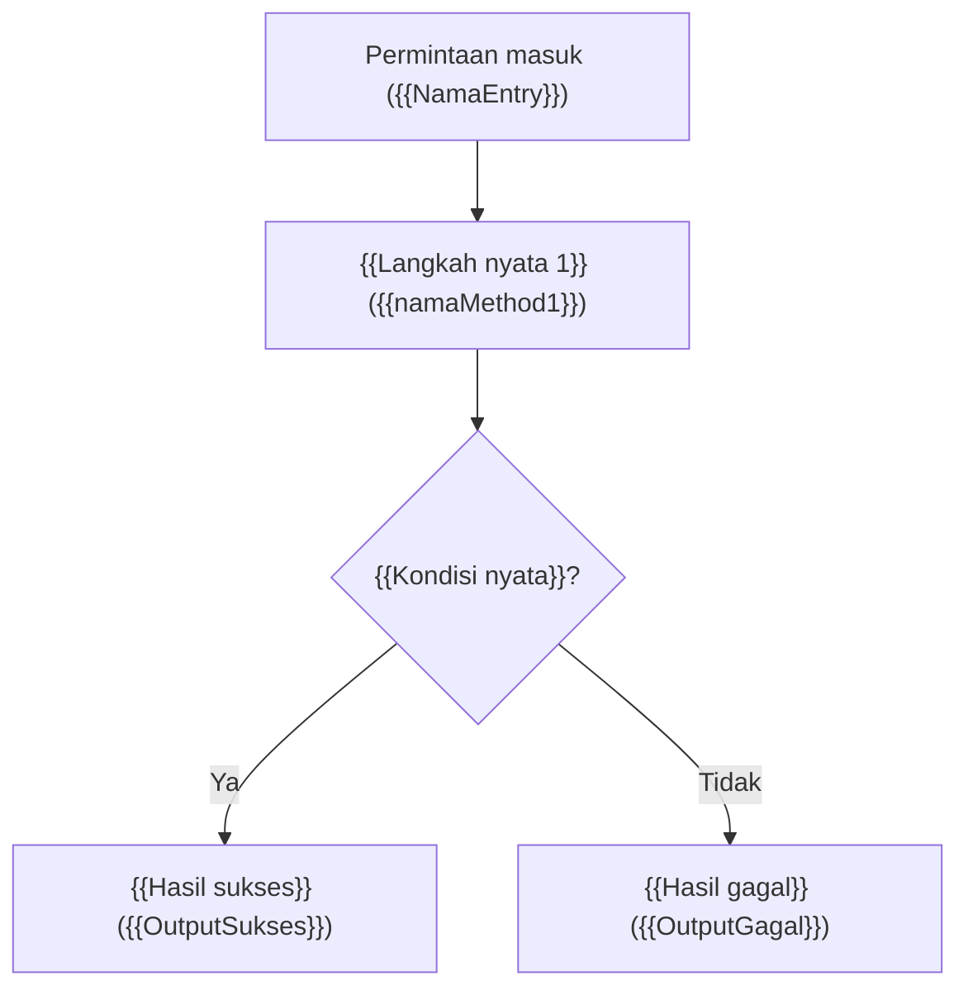

<!-- babydocs:start -->
<!-- babydocs:hash={{HASH_FOLDER_DARI_PETA_PROYEK}} -->
<!--
  TEMPLATE README SUB-FOLDER (LEVEL FILE + CLASS + KOMPONEN + FUNGSI)
  - Ganti semua {{PLACEHOLDER}} dengan informasi NYATA dari kode yang dibaca.
  - Hapus bagian yang tidak relevan (mis. hapus "Props" jika ini service non-UI, hapus "Screenshot" jika backend).
  - DILARANG mengisi teks generik seperti "Menangani bagian X" atau diagram 2-node dummy.
  - Hapus komentar petunjuk ini sebelum menyimpan, KECUALI penanda babydocs:start / babydocs:hash / babydocs:end.
-->

# {{EMOJI}} {{NAMA_FOLDER_RAMAH}}

> **Singkatnya:** {{SATU_KALIMAT_ELI5_SPESIFIK — jelaskan peran nyata folder ini, bukan kalimat umum}}

📁 Lokasi: `{{PATH_FOLDER_DARI_ROOT}}` · 🧩 Tipe: `{{web-ui | mobile-ui | backend-api | cli-library}}`

---

## 🪆 Penjelasan Super Sederhana

{{ANALOGI_BESAR — 3 s.d. 6 kalimat pendek yang spesifik terhadap perilaku kode di folder ini. Satu dunia analogi untuk seluruh folder.}}

> 🔧 **Aslinya:** {{RINGKASAN_TEKNIS — sebutkan class/komponen/entry utama dan cara folder ini dipakai oleh bagian lain.}}

---

## 👀 Lihat Wujudnya

<!-- [A] UNTUK web-ui / mobile-ui: Screenshot -->
### 📸 Screenshot


*{{Keterangan: apa yang sedang kita lihat, tunjuk bagian penting.}}*

<!-- [B] DIAGRAM ALUR NYATA (wajib pakai nama class/method/state asli, minimal 3 node bermakna) -->
### 🗺️ Diagram Alur



---

## 🧩 Bedah Komponen, Class & Fungsi

<!-- Ulangi blok ### di bawah untuk SETIAP class / komponen / widget / service penting di folder ini -->

### 1. `{{NamaClassAtauKomponen}}`

{{2–3 kalimat analogi ELI5 yang menjelaskan persis apa tugas class/komponen ini.}}

> 🔧 **Aslinya:** `{{nama_file.ext}}` → `{{class/component/widget NamaClassAtauKomponen}}`

<!-- Jika ini KOMPONEN / WIDGET UI: tampilkan Props / Parameter -->
**Props / Parameter:**

| Nama | Tipe / Wajib | Artinya (bahasa sederhana) |
|---|---|---|
| `{{prop1}}` | `{{String}}` (wajib) | {{penjelasan singkat}} |
| `{{onTap}}` | `{{VoidCallback?}}` (opsional) | {{apa yang terjadi saat dipicu}} |

<!-- Jika ini CLASS / SERVICE / CUBIT / CONTROLLER / REPOSITORY: tampilkan Method / Aksi -->
**Method / Aksi:**

| Method | Input | Output / Efek | Tugas (bahasa sederhana) |
|---|---|---|---|
| `{{methodA(param)}}` | `{{param: Tipe}}` | `{{Return / emit State / HTTP call}}` | {{apa yang dilakukan method ini}} |
| `{{methodB()}}` | `—` | `{{...}}` | {{...}} |

**Contoh Pemakaian:**

```{{bahasa}}
{{CONTOH_NYATA — pemanggilan komponen, method, atau request/response berdasarkan kode}}
```

---

<!-- Jika ada fungsi-fungsi lepas (utility, helper, mapper, validator, hook): -->
### ⚙️ Fungsi Lepas

| Fungsi | File | Input | Output | Tugas (bahasa sederhana) |
|---|---|---|---|---|
| `{{namaFungsi(a, b)}}` | `{{file.ext}}` | `{{a: Tipe, b: Tipe}}` | `{{TipeReturn}}` | {{penjelasan singkat & spesifik}} |

---

## 📋 Ringkasan File

| Nama File | Isi Utama (Class / Komponen / Fungsi) | Peran Singkat |
|---|---|---|
| `{{file_1.ext}}` | `{{ClassA}}`, `{{helperB()}}` | {{Peran spesifik dalam 1 kalimat pendek}} |

<!-- Hapus bagian ini jika folder tidak punya sub-folder ber-README -->
### 📂 Sub-folder

| Folder | Ibaratnya | Buka |
|---|---|---|
| `{{nama-subfolder}}` | {{ringkasan analogi 1 kalimat}} | [README]({{path/dari/root/ke/subfolder/README.md}}) |

---

## 🔗 Berhubungan Dengan

- **Dipakai oleh:** {{folder/file yang memanggil folder ini — tautkan README-nya}}
- **Memakai:** {{folder/library yang dipanggil folder ini}}

<!-- babydocs:end -->
