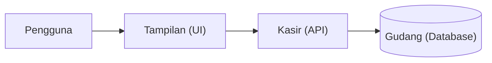

<!-- eli5-visual-docs:start -->
<!--
  TEMPLATE README ROOT (halaman depan Docsify)
  Ganti semua {{PLACEHOLDER}}, hapus komentar petunjuk, pertahankan penanda start/end.
-->

# {{EMOJI}} {{PROJECT_NAME}}

> **Proyek ini ibarat** {{ANALOGI_SATU_KALIMAT — mis. "sebuah restoran: ada pelayan (aplikasi HP), kasir (API), dan dapur (database)."}}

---

## 🌍 Gambaran Besar

{{ANALOGI_BESAR — 4 s.d. 8 kalimat pendek menjelaskan seluruh sistem dari sudut pandang pengguna.}}

> 🔧 **Aslinya:** {{BAHASA}} + {{FRAMEWORK}} ({{TIPE_PROYEK}}). Entry point: `{{ENTRY_FILE}}`.

## 🗺️ Peta Arsitektur



## 🧭 Peta Navigasi

| Bagian | Ibaratnya | Buka |
|---|---|---|
| `{{path/folder}}` | {{analogi 1 kalimat}} | [README]({{path/folder/README.md}}) |

## 🚀 Cara Menjalankan Proyek

```bash
{{PERINTAH_INSTALL — dari scripts / Makefile / README lama}}
{{PERINTAH_RUN}}
```

## 📖 Cara Membuka Dokumentasi Ini

```bash
npx -y docsify-cli serve .     # buka http://localhost:3000
# atau
python3 -m http.server 3000    # buka http://localhost:3000
```

> Dokumentasi ini dibuat dengan **eli5-visual-docs**. Jalankan ulang skill setelah kode berubah agar tetap up-to-date.

<!-- eli5-visual-docs:end -->
