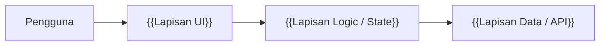

<!-- babydocs:start -->
<!--
  TEMPLATE README ROOT (halaman depan dokumentasi)
  Ini acuan fleksibel — sesuaikan bagian dan gaya bahasanya agar natural untuk proyek ini.
  Ganti semua {{PLACEHOLDER}}, hapus komentar petunjuk, pertahankan penanda start/end.
-->

# {{PROJECT_NAME}}

> {{RINGKASAN_SATU_KALIMAT_NATURAL — proyek ini aplikasi apa dan untuk siapa}}

---

## Gambaran Besar

{{3–6 kalimat santai dan jelas menjelaskan apa yang dilakukan aplikasi ini dari sudut pandang pengguna.}}

> 🔧 **Di kode:** {{BAHASA}} + {{FRAMEWORK}} (`{{TIPE_PROYEK}}`) · Entry point: `{{ENTRY_FILE}}`

---

## Kenapa Pakai Arsitektur {{NAMA_ARSITEKTUR}}?

{{Jelaskan pola arsitektur proyek ini dengan analogi yang mudah dicerna — lalu jawab KENAPA proyek ini dipisah menjadi lapisan/folder seperti sekarang, masalah apa yang dihindari, dan apa untungnya saat fitur makin banyak.}}



---

## Library & Package Utama (dan Perbandingannya)

<!-- Jika daftarnya panjang (> 6 package), buat halaman khusus tech-stack.md dan tautkan dari sini & sidebar -->
| Package | Tugasnya (bahasa sederhana) | Dipakai di | Pesaing Utama | Kelebihan | Kekurangan |
|---|---|---|---|---|---|
| `{{pkg_1}}` | {{peran singkat}} | `{{folder/file}}` | {{pesaing A, B}} | {{plusnya}} | {{minusnya}} |
| `{{pkg_2}}` | {{peran singkat}} | `{{folder/file}}` | {{pesaing A, B}} | {{plusnya}} | {{minusnya}} |

---

## Peta Navigasi

| Area | Fokusnya | Buka |
|---|---|---|
| **{{Nama Area Natural}}** (`{{path/folder}}`) | {{penjelasan singkat 1 kalimat}} | [Lihat]({{path/folder/README.md}}) |

---

## Cara Menjalankan Proyek

```bash
{{PERINTAH_INSTALL}}
{{PERINTAH_RUN}}
```

## Cara Membuka Dokumentasi Ini

```bash
babydocs serve            # buka http://localhost:3000
babydocs serve --open     # sekaligus membuka browser
```

<!-- babydocs:end -->
